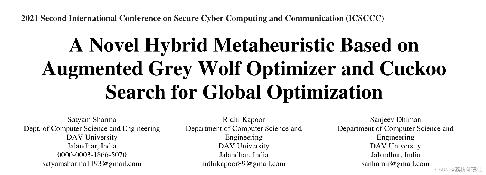
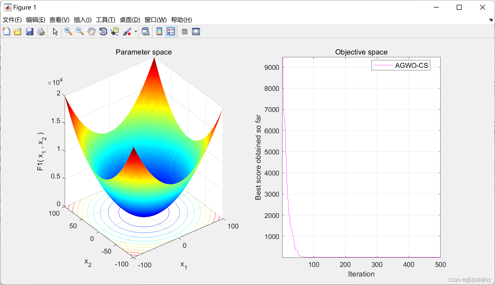

# Solution of Single-Objective Optimization Problem Based on the Grey Wolf Optimization Algorithm with Coalition Search (AGWOCS)

​  
Editor
The Grey Wolf Optimization Algorithm (GWO) is an intelligent metaheuristic method that mimics the leadership hierarchy and cooperative hunting behavior of a pack of grey wolves. Recently, an enhanced version of GWO, known as Enhanced Grey Wolf Optimization (AGWO), has been proposed with greater exploration capabilities. However, in certain cases, AGWO performs poorly during the development phase, stalling at local optima. The CS algorithm, inspired by nature, mimics the unique nest-building strategies of woodpeckers and tax-collecting birds. Both algorithms possess strong search capabilities. In our research work, we propose a new hybrid metaheuristic algorithm, called AGWOCS, which combines the strengths of two metaheuristic algorithms to effectively obtain global optima. The proposed algorithm integrates the exploration capability of AGWO with the development capability of the Woodpecker Search (CS) for testing the effectiveness of our proposed hybrid AGWOCS. A total of 23 well-known benchmark functions were used for this purpose. It was compared with six existing metaheuristic methods, including standard GWO, Particle Swarm Optimization (PSO), Enhanced GWO (EGWO), Enhanced Grey Wolf Optimization (EGWO), CS Hybrid Grey Wolf Optimization (CS-GWO), and Hybrid PSO and GWO (GWOPSO). Simulation results show that AGWOCS outperforms other metaheuristic algorithms in terms of rapid convergence speed and avoiding local optima.
📚2 Running Results Editing
Part of the code:
function [Alpha_score,Alpha_pos,Convergence_curve]=AGWO_CS(SearchAgents_no,Max_iter,lb,ub,dim,fobj)  
% initialize alpha_pos, beta_pos.  
% p=initialization(SearchAgents_no,dim,ub,lb);  
Alpha_pos=zeros(1,dim);  
Alpha_score=inf; %change this to -inf for maximization problems  
Beta_pos=zeros(1,dim);  
Beta_score=inf; %change this to -inf for maximization problems  
%Initialize the positions of search agents  
Positions=initialization(SearchAgents_no,dim,ub,lb);  
Positions=sort(Positions);  
oldPositions=Positions;  
Convergence_curve=zeros(1,Max_iter);  
l=0;% Loop counter  
% Main loop  
while l<Max_iter  
for i=1:size(Positions,1)  
% Return back the search agents that go beyond the boundaries of the search space  
%    Flag4ub=Positions(i,:)>ub;  
%    Flag4lb=Positions(i,:)<lb;  
%    Positions(i,:)=(Positions(i,:).*(~(Flag4ub+Flag4lb)))+ub.*Flag4ub+lb.*Flag4lb;  
%    Positions(i,:)=sort(Positions(i,:));  
% Calculate objective function for each search agent  
%    [Positions(i,:), fitness(i)]=objf(Positions(i,:)',measuredPos,measuredPos,BlindDeviceID,actualRefLocs,refDeviceID,Range,x);  
fitness(i)=fobj(Positions(i,:));  
% Update Alpha, Beta, and Delta  
if fitness(i)<Alpha_score  
Alpha_score=fitness(i); % Update alpha  
Alpha_pos=Positions(i,:);  
end  
if fitness(i)>Alpha_score && fitness(i)<Beta_score  
Beta_score=fitness(i); % Update beta  
Beta_pos=Positions(i,:);  
end  
end  
a=2-(cos(rand())*l/Max_iter); % a decreases non-linearly fron 2 to 1.  
% Update the Position of search agents including omegas  
for i=1:size(Positions,1)  
for j=1:size(Positions,2)  
r1=rand(); % r1 is a random number in [0,1]  
r2=rand(); % r2 is a random number in [0,1]  
A1=2*a*r1-a; % Equation (4)  
C1=2*r2;  % Equation (5)  
D_alpha=abs(C1*Alpha_pos(j)-Positions(i,j)); % Equation (6)-part 1  
X1(i,j)=Alpha_pos(j)-A1*D_alpha; % Equation (7)-part 1  
r1=rand();  
r2=rand();  
A2=2*a*r1-a; % Equation (4)  
C2=2*r2;  % Equation (5)  
D_beta=abs(C2*Beta_pos(j)-Positions(i,j)); % Equation (6)-part 2  
X2(i,j)=Beta_pos(j)-A2*D_beta; % Equation (7)-part 2  
end  
end  
%% Cuckoo Search integrated here and take control from AGWO  
% the key group members of AGWO are updated by cuckoo search's position updation formula  
%  
[~,index]=min(fitness);  
best=Positions(index,:);  
X1=get_cuckoos(X1,best,lb,ub);  
X2=get_cuckoos(X2,best,lb,ub);  
%% control is sent back to AGWO  
Positions=(X1+X2)/2;% Equation (8)  
%  Positions=sort(Positions);  
if Positions(i,j)>ub  
Positions(i,j)=ub;  
elseif Positions(i,j)<lb  
Positions(i,j)=lb;  
end  
l=l+1;  
Convergence_curve(l)=Alpha_score;  
end  
end  
🎉3 References
🌈4 Matlab code implementation

## Images

<!-- PAYMENT_BLOCK -->

## Get this dataset

- Payment link (Stripe): [Buy now](https://buy.stripe.com/3cs8yP7sY87d0vu9AB)
- Payment QR code: 

<!-- /PAYMENT_BLOCK -->
